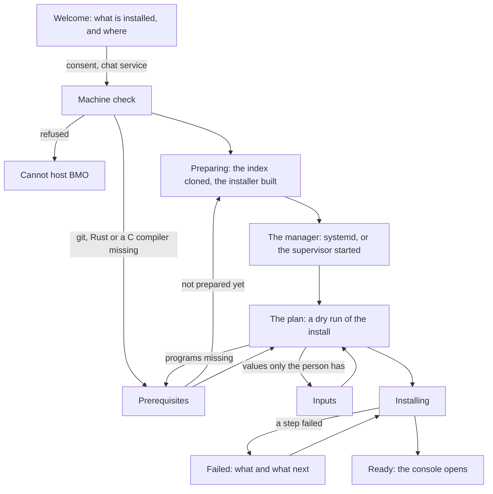

# The all-in-one app

The all-in-one app carries the whole BMO set on the person's own computer: it installs the personal preset
there, runs it, and shows its console in a window of its own. It is the second desktop app beside the remote
controller (docs/desktop.md), which shows a server's hosted console and carries a jake agent. This document is
the canonical statement of the all-in-one; the `desktop` crate built with its `all-in-one` feature answers to it.

## What it is

- **The personal preset of the BMO set, installed and run on this machine.** One person and their own BMO: the
  console, memory, coding agents, one chat service and their own documents, notes, calendar, files, mail and
  remote desktop, as the index's `presets.toml` lists the preset. No hub and no other server is needed: the
  console, its account service and every service run here, on loopback.
- **The console served locally, in the app's window.** The window shows the console at the address the install
  reports, `http://127.0.0.1:3210/bmo/` unless the port moved, and nothing else; the console is the set's own,
  not a copy bundled into the app.
- **The installer is the set's own.** The app drives the testbed's `install` verb with the personal preset, the
  same verb an agent runs from the index's `INSTALL.md`, with the person's consent before anything is written.
  It never installs a repository by a road of its own: every clone, settings file, database and first
  deployment is the verb's, and the app reads its JSON lines and answers what they ask.
- **The set runs under the machine's own manager or under the testbed's supervisor.** Where a systemd user
  manager runs, the set's units are systemd's, as on a server. Where none runs, the app runs the testbed's
  supervisor (bmo-testbed's `docs/supervise.md`), which runs the same units from the same files; on Windows the
  set runs inside a WSL 2 distribution under the supervisor (「Windows through WSL 2」).
- **A tray icon** opens the console, shows the set's health, and quits. **Quitting stops the set**, and starting
  the app starts it again.
- **One copy at a time,** as the remote controller: a second launch brings the running copy's window forward.

## The crate

- **The same `desktop` crate, built with the `all-in-one` feature,** and with the Tauri configuration
  `tauri.all-in-one.conf.json` laid over the crate's own, which names the product `BMO All-in-One`, its own
  identifier `io.ahas.bmo.all-in-one` and its own updater feed (「Updates」). The two apps install side by side,
  each with its own settings and its own registration at sign-in.
- **What they share** stands in the crate once: the settings file and its switches, where the window may
  navigate, starting at sign-in and the update channel. Each builds its own frameless window, tray and console
  bridge from them, the all-in-one's bridge giving the console the same window commands and settings' read.
- **What each has of its own:** the remote controller's agent, pairing, credential store and server page are
  built only without the feature; the all-in-one's first run, its runner of the installer, the set's manager and
  WSL's bootstrap are built only with it, under `src/all_in_one/`, with bundled pages under `ui/all-in-one/` and
  capabilities under `capabilities/all-in-one/`.
- **Its checks:** `bun run check:desktop` lints and tests both builds, the remote controller's and the
  all-in-one's.

## Where everything stands

| What | Where |
|---|---|
| The index, the checkout every repository is cloned into | `~/bmo` |
| The set's settings, tokens, inputs and state | The data root, `~/.local/share/bmo/data` |
| Every service's releases | The install prefix, `~/.local/share` |
| The supervisor's socket, state and logs, where it runs | `supervise/` under the data root |
| The app's own record | `all-in-one.json` in the app's config directory |

- **The app's record** keeps what the app itself decided with the person: that they consented and when, the chat
  service they chose, the manager the set runs under, and the console's address once the install
  reported it. Everything else is read from the machine and the installer each time, as the installer itself
  reads it.
- **On Windows** the index, the data root and the prefix stand inside the distribution, under its account's home,
  and the distribution's disk stands under the app's local data directory.

## The first run

The first run walks the person from nothing to the console, one screen at a time, each screen a state of the
flow. Every step can be taken again: a rerun of any step continues where it stopped, as the installer does.

- **Welcome.** What the personal preset is, in a few lines; the folders it is written into; the room it needs, 16 GB
  of memory and 60 GB of disk; that it builds every service from source, which takes a long time once; and which
  chat service BMO talks through besides the console, Telegram or Discord, chosen here. Nothing happens before the
  person consents, and the consent is written into the app's record.
- **Machine check.** The machine is read once, by a probe run where the set will run: Linux, an x86-64 or ARM
  processor, an ordinary account rather than root, the memory and the free disk, whether a systemd user manager
  runs, and whether git, Rust and a C compiler stand. The memory is the machine's, or the ceiling of the container
  the set runs in where that is lower. A machine that is not Linux, not 64-bit or is root's is refused with the
  reason; too little memory or disk is said and asked to be accepted. Where git, Rust or a C compiler is missing,
  as on a fresh system, the prerequisites (「Prerequisites」) come first, since preparing clones with git and builds
  the installer with Rust, and preparing follows them.
- **Preparing.** The index is cloned from its public repository, or brought up to its main branch where it
  stands, and the installer is built from source as `INSTALL.md` 「Lay down the index and build the installer」
  states: the base libraries and the testbed cloned into the index, or brought up to their main branches where
  they stand, then the testbed's binary built, so a retry builds the installer the testbed holds now. Each command's
  last lines are shown as it runs.
- **The manager.** With a systemd user manager the set runs under it and nothing more is started. Without one the
  app starts `bmo-testbed supervise serve` as its child and hands every installer command the lines
  `bmo-testbed supervise env` prints.
- **The PATH.** The supervisor, `supervise env` and, under systemd, every installer command run with the account's
  own tool folders, `~/.cargo/bin`, `~/.local/bin` and `~/.bun/bin`, before the PATH the app started with, since a
  session that began before the prerequisites installed them does not hold them, and the installer's `needs:`, every
  build and every unit under the supervisor read the PATH.
- **The plan.** The installer runs with `--dry-run`, `--preset personal` and `--with` naming the chat service, and
  its lines are read as they come:
  - a `needs:` line that failed is a missing program, listed with its `detail`, which says what it is for and
    where it comes from (「Prerequisites」);
  - a `needs-input` line is a value only the person has (「Inputs」);
  - with neither, the plan is shown as the steps it names, and the install goes on.

  A dry run clones nothing, so on a fresh index it reads the declarations of the repositories preparing cloned
  alone; the first real run clones the rest and stops, before any settings or deployment, at the programs and
  values they need, which go to the same screens and back to the plan.
- **Prerequisites.** Everything the preset's `needs:` lines name that a script can install is installed on one
  press. As root, asked through the system's own prompt (`pkexec` on Linux) and never through the app: the
  system's packages of `INSTALL.md` 「Install the prerequisites」 with tmux, ffmpeg, rsync, Xvfb, Poppler's
  utilities and gnome-remote-desktop, Google Chrome from Google's package where neither it nor an opened Firefox
  snap stands, and PostgreSQL and Valkey started where no systemd starts them. For the account, in its own folders:
  Rust and Bun by their own installers, Zig at the version herdr's build names, checked against Zig's download
  index, uv with LiteLLM's proxy, and Claude Code. What only the person can do, Claude Code's sign-in in a browser
  among it, is said as such. Preparing then goes on where the machine check held it back, or else the plan
  is read again.
- **Inputs.** Each value the installer asks for is a field, under the line's `detail`: the console's name and
  password, what BMO calls the person, their chat service's bot token and their own id on it, and the remote
  desktop's password. Each value is handed to `install --set <name>` on its standard input alone; a value never
  stands on a command line, in a log or in the app's record. The plan is then read again.
- **Installing.** The installer runs for real, each line moving the progress: the step, its status and its detail,
  the deployments counted out of the preset's repositories. A real run takes as long as the builds take, and nothing
  cuts it short.
- **Failed.** A `failed` line stops on a screen with its `detail` and its `next`, and an offer to run the install
  again once it is mended; the run continues where it stopped.
- **Ready.** The `done` line's `next` is the console's address; it is written into the app's record and the
  window opens it. Every later start of the app starts the set and opens the console at once.

## Running the set

- **Under systemd** the set's units are the user manager's, as the install leaves them. The app reads their state
  with `systemctl --user show`, starts them as it starts with `systemctl --user start`, and stops them as it quits.
- **Under the supervisor** the app runs `bmo-testbed supervise serve` as its child for as long as it runs. Starting
  it starts every enabled unit; the app reads their state with `bmo-testbed supervise status --json`; quitting asks
  `bmo-testbed supervise stop-all` and waits for it, so every unit is stopped before the app ends.
- **The set's units** are the enabled services whose unit files stand in a release under the install prefix, the
  ones a deployment of the set linked; no other unit of the account is touched.
- **The tray reads the set's health every 30 seconds:** its tooltip says the set runs well, how many of its units
  are down or unhealthy, or that it is starting or stopping. A unit marked `bot` reads its declared health under
  the supervisor; under systemd only its state is read.
- **A unit that crashes is the manager's to start again,** by its own `Restart=`, under systemd and the supervisor
  alike; the app never restarts a unit itself.

## Updates

- **The app updates itself through Tauri's updater,** as the remote controller does (docs/desktop.md,
  「Distribution and updates」), from feeds of its own beside the remote controller's on the public repository's
  GitHub releases: `all-in-one-latest.json` on the latest release for `stable`, and the same file of the nightly
  pre-release for `nightly`. Each release carries both apps' installers, built from one commit by the same
  `bun run release:desktop` (docs/desktop.md, 「Making a release」), and the read `release.json` names the
  all-in-one's under `allInOne`.
- **The set's repositories update through the testbed's deployment,** as every install's do: each repository's
  later commits on GitHub go live by `bmo-testbed deploy` in its checkout. The app does not deploy; the set's own
  supervisor agent puts newer commits live, as on a server.
- **No address in the app names any deployment.** The index, the repositories and the releases are the public
  repositories on GitHub; the console is this machine's own.

## Windows through WSL 2

On Windows the set runs inside a WSL 2 distribution of its own, the way Docker Desktop runs its engine: the app is
a Windows program, and every command of the first run and of the set runs inside the distribution.

- **WSL 2 is checked first:** `wsl.exe --status` answering says it stands. Where it does not, the app offers to
  install it with `wsl.exe --install --no-distribution`, which asks for the administrator's consent through Windows
  and may need a restart, and says so.
- **The distribution is named `BMO`.** Where `wsl.exe --list --quiet` does not list it, the app downloads Ubuntu's
  WSL image from Ubuntu's own release folder, checks it against the folder's `SHA256SUMS`, and imports it with
  `wsl.exe --import BMO <folder> <image> --version 2`, its disk under the app's local data directory.
- **The distribution is laid out once, as root,** by the bootstrap script the app carries,
  `src/all_in_one/scripts/wsl-bootstrap.sh`, handed to `wsl.exe -d BMO -u root` on standard input: the person's
  account made under their Windows account's name, written as the distribution's default user; Windows' PATH kept
  out of the distribution's, so no Windows folder with a space in it stands on the set's PATH; and systemd left off,
  since the set runs under the supervisor. The system's packages come with the first run's prerequisites, as on
  Linux, run as root in the distribution.
- **Every command runs in the distribution:** the app runs each as `wsl.exe -d BMO -u <account> --`, the same
  commands the Linux flow runs, and reads their output as it does on Linux.
- **PostgreSQL and Valkey start with the set:** the app starts them through their service scripts as root, then the
  supervisor as the account, each time it starts. The distribution lives while the supervisor's `wsl.exe` runs, and
  WSL ends it once the app has stopped the set and quit.
- **The console reaches Windows on loopback.** WSL 2 forwards a port the distribution listens on at its own
  loopback to Windows' loopback, so the window opens the same address the install reports.
- **WSL's own memory ceiling holds:** WSL 2 gives the distribution half of the machine's memory unless the
  person's `.wslconfig` says otherwise, and the machine check reads the memory the distribution sees.

## What is not built yet

- **The Windows road is built and not yet run on Windows:** the WSL checks, the image's download and check, the
  import, the bootstrap and the commands wrapped for the distribution are tested as words on Linux alone.
- **Updating the set's repositories from the app** is the set's own supervisor agent's work, as on a server; the
  app offers no button of its own for it.

## What the app says on the download page

The site's download section offers the two desktop apps side by side, read from the latest release's
`release.json` (docs/desktop.md, 「The read the console uses」):

- **BMO 원격 제어기** (the remote controller): your BMO server's console in a window, with this PC joined to it as a
  machine BMO can work on. Needs a BMO server.
- **BMO All-in-One**: BMO itself on this PC, installed and run here, with its console in a window. Needs no server;
  Linux with 16 GB of memory and 60 GB of disk, or Windows with WSL 2.
