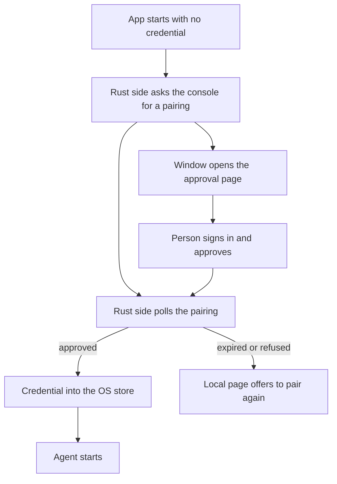

# The desktop app

The desktop app is BMO's web console in a window of its own that carries a jake agent inside it. It is
the second way a person's machine is joined to the hub, beside the one-line install (docs/install.md),
which stays as it is. This document is the canonical statement of the app; the `desktop` crate answers
to it.

## What it is

- **The hosted console in a window.** The main window loads the console the deployment serves, not a
  copy bundled into the app: the console is rendered on its server and relays through that server, so
  only the hosted one works. Its address is a setting, `consoleUrl` in the app's `settings.json` under
  the app's per-user config directory, and defaults to `https://ai.example.org/bmo/`.
- **A built-in agent while the app runs.** The app runs the agent crate as a library on its own
  runtime, under the person's own machine credential, so the machine is reachable through the hub for
  as long as the app is open, with the same shells, transfers and streams an installed agent offers.
- **A tray icon.** Closing the window hides it and the agent carries on; the tray opens the console
  again, shows the agent's state, turns starting at sign-in on and off, and quits. Quitting stops the
  agent.
- **One copy at a time.** A second launch brings the running copy's window forward and exits, since two
  copies would hold one name twice.
- **Starting at sign-in is off until the person turns it on,** through Tauri's autostart plugin: a
  per-user registration that needs no administrator rights.

## The crate and its workspace

- **`desktop` is a Cargo workspace of its own inside this repository,** reading the agent crate by its
  path, so the app and the installed agent run the same code with no dependency across repositories.
- **It stands outside the root workspace for two present reasons.** The root workspace is what the
  hub's deployment builds and lints in full, every package of it, and that build must need no webview
  system libraries and pay no webview build time. And the root's release build aborts on a panic,
  while the app is built with unwinding so that a panic in the agent ends only the agent's task.
- **Its checks are run apart:** `bun run check:desktop` lints, formats and tests it, on a machine that
  has the webview libraries (on Linux, WebKitGTK 4.1 and its development files). `bun run check`
  stays the whole check of the root workspace and the console.

## The agent as a library

- **The agent crate is a library as well as the `jake` executable.** The executable reads `agent.env`
  and runs as it always has; the library entry is what the app calls.
- **The entry takes its configuration in memory:** the hub URL, the agent's name and its credential,
  with every other setting at the default an empty `agent.env` would give. It reads no file and no
  environment variable.
- **It runs on the caller's runtime** and ends when the caller's stop signal resolves, when the hub
  sends a leave, or, where the caller asked for it, when the hub hands the agent's name to another
  connection. Its answer says which of the three ended it.
- **It reports its link as it goes:** connecting, attached, refused by the hub, or unable to reach it,
  through a watch the caller reads.
- **A leave asks nothing of the machine.** The library does not uninstall anything; the executable
  runs its departure after the entry answers that the hub sent a leave, and the app forgets its
  credential instead (「Keeping the agent running」).

## Pairing

The app never asks for the shared secret and never shows a credential. It obtains the person's own
machine credential, `<name>.<mac>` (docs/architecture.md, 「Configuration and secrets」), through the
console's device pairing, which the account service mints for the machine the signed-in person's
account is bound to.

- **The contract with the console.** A pairing is asked for with an unauthenticated
  `POST /api/desktop/pairings` under the console's address, answered with the pairing's id, a short
  code, the approval page's address and how many seconds to wait between polls. The app polls
  `GET /api/desktop/pairings/<pairing>`: 202 while waiting, 200 with the machine's name, its credential
  and the hub's URL once approved, which is answered once only, and 410 once the pairing expired or was
  refused. A pairing expires after ten minutes.
- **The page never touches the credential.** The Rust side asks for the pairing and polls it over its
  own HTTPS client; the window only shows the approval page, so the credential never passes through
  the page's JavaScript.
- **The code is shown on both sides.** The app shows the pairing's code in its window title and on its
  local page, and the approval page shows the same code, so the person can see they are approving this
  app.
- **The answer is checked before it is kept:** the credential must name the machine the answer names,
  and the hub's URL must be a WebSocket address. An approval page outside the console's origin is
  refused.
- **A pairing that fails is offered again,** by a button on the local page; the app never asks the
  console for pairings in a loop of its own.

## The credential's storage

- **The credential is kept in the operating system's credential store**, through the `keyring` crate:
  Windows Credential Manager, the Secret Service on Linux, the Keychain on macOS. One entry, under the
  service `io.ahas.jake.desktop`, holds the machine's name, its credential and the hub's URL.
- **Where no store stands, nothing is kept.** On a Linux machine with no Secret Service, a headless one
  or a WSL distribution without a desktop session, the app says the credential cannot be kept, starts
  no pairing and runs no agent. It never writes the credential to a file.
- **A credential the hub refuses is kept.** The agent keeps redialling and the state reads as refused,
  since a refusal from a hub that has not yet learnt the key is cured on the hub's side.

## Keeping the agent running

- **The agent runs as one task the app supervises.** The app is built with unwinding, so a panic ends
  that task alone and the app stays up.
- **A task that panics is started again after a pause** that doubles from one second to a ceiling of
  five minutes, and returns to one second once a run has lasted ten minutes. The state reads as
  restarting while it waits.
- **A leave from the hub ends the built-in agent for good:** the app deletes the stored credential,
  stops the agent and offers pairing again, since the hub has removed this machine.
- **The state is shown** in the tray icon's tooltip and on the local page: starting, pairing, pairing
  failed, no credential store, connecting, attached, refused by the hub, hub unreachable, restarting
  after a fault, held off for an installed agent, given up to another agent of its name, and removed
  by the hub.

## One agent per name

The hub keeps one connection per name, and a newer hello replaces the older (docs/architecture.md,
「Many agents, one hub」). Two agents of one name that both redialled would replace each other without
end, so the built-in agent gives way, twice over.

- **It does not start beside an installed agent of its name.** Before the agent starts, the app looks
  for an installed jake agent running on the machine: on Windows by the agent's single-instance lock in
  its data directory, held by a live process; on Linux by the main process of the `jake-agent` user
  unit. The running executable's own folder holds the `agent.env` that names it. Where that name is the
  built-in agent's, the built-in agent stays off and the app says an installed agent already serves
  this machine, offering to keep using it, with a button that looks again.
- **It yields to any agent that takes its name.** When the hub closes the built-in agent's connection
  as superseded by a new one, the built-in agent stops instead of redialling, and the app reads as held
  off for another agent of its name. An installed agent the first check cannot see, one inside a WSL
  distribution of the same machine, therefore wins after a single replacement, and the two never loop.
- **The installed agent is unchanged:** it redials when superseded, as it always has.

## The window and what the console may call

- **Navigation stays on the console's origin.** The main window goes only to the console's origin and
  to the app's own bundled page; a link to anywhere else opens in the person's default browser.
- **The bundled page** says when the console cannot be reached, shows the agent's state and the
  pairing code, and offers to try the console again, pair again, or look again for an installed agent
  or a credential store.
- **The console's origin gets no Tauri command.** Pairing needs no hand-off from the page, because the
  Rust side polls for the approval itself, so no capability lists a remote origin. The bundled page
  alone may call the app's three commands, each named in its capability: read the status, try the
  console again, and retry (pair again, or look again).
- **The console is checked before it is shown:** the app asks the console's address over HTTPS first,
  and shows the bundled page with the reason when it does not answer.

## Distribution and updates

- **Windows first:** an NSIS installer that installs for the current user alone and needs no
  administrator rights. It is unsigned until an Authenticode certificate exists, which is the owner's
  decision, so Windows SmartScreen warns on first run until then.
- **Linux second:** an AppImage and a deb package.
- **Updates go through Tauri's updater plugin with its signature check.** The app checks the feed at
  start and every six hours, and installs an update only once its signature verifies against the
  public key built into the app.
- **The update key is the owner's.** It is made once with `cargo tauri signer generate`, which writes a
  private key and asks for its password; the private key and its password are kept outside every
  repository, in the deployment's secret store (the data root's env folder), a file each, readable by
  their user alone, and are handed to a release build through the `TAURI_SIGNING_PRIVATE_KEY` and
  `TAURI_SIGNING_PRIVATE_KEY_PASSWORD` environment variables alone. Neither is ever committed. The
  public key is written into the updater's `pubkey` in the app's Tauri configuration.
- **The public key is written in, and the bundle makes updater artifacts,** which a release build signs
  with the private key; a release build without the two variables fails rather than ship an unsigned
  update. The app checks the feed and installs an update in Windows's passive mode, showing its progress
  and asking nothing. An app built from a configuration with no updater entry checks for none.
- **The feed is served beside the agent's builds,** at `https://ai.example.org/bmo/jake/desktop/latest.json`,
  with the installers and their signatures it names (「Releases」).
- **A build** runs `cargo tauri build` inside the `desktop` folder. The NSIS installer is built on
  main-host as well as on a Windows machine: cross-compiled for `x86_64-pc-windows-gnu` with
  `cargo-zigbuild` as the CLI's runner and `--bundles nsis`, which needs `nsis` and the mingw-w64
  binutils and C compiler for the app's Windows resources. The AppImage and the deb are built on a
  Linux machine with WebKitGTK.

## Releases

A release is one version of the app, built for every platform at once, signed for the updater and
published where both the updater and the console read it.

### Where releases are kept

- **The release folder is the `desktop` folder of the agent's served layout:** on main-host the
  directory `/var/www/ahas-ai/bmo/jake/desktop/`, which the `ai.example.org` site serves statically as
  `https://ai.example.org/bmo/jake/desktop/`. The folder belongs to the user that runs releases, so a
  release writes it without root; serving the path is host infrastructure BMO owns.
- **Each version has a folder of its own,** named by the bare version (`0.1.0`), holding the Windows
  installer, the AppImage and the deb, each beside its updater signature, and that version's release
  read. A published version is never written again: the updater installs only a version higher than
  the running one, so a fix ships as a new version.
- **Two files at the folder's top name the current version:** `latest.json`, the updater's feed in
  the form Tauri's updater reads, and `release.json`, the read the console uses. Both are replaced
  whole, each by a rename, and only once the version's folder is complete, so neither ever names a
  file that is not yet there.
- **The feed names every installer the updater may take,** each with its signature and its address:
  the NSIS installer under `windows-x86_64-nsis` and `windows-x86_64`, the AppImage under
  `linux-x86_64-appimage` and `linux-x86_64`, and the deb under `linux-x86_64-deb`. An app installed
  from the deb looks for the deb's key first, so it is never handed an AppImage.

### The read the console uses

The console builds its download page against this contract alone.

- **It reads `https://ai.example.org/bmo/jake/desktop/release.json`,** a JSON object that always describes
  the current version. The same object is kept in that version's own folder, at
  `https://ai.example.org/bmo/jake/desktop/<version>/release.json`, and never changes there.
- **The object holds:** `version`, the bare semantic version; `date`, when it was published, as an
  RFC 3339 UTC timestamp; and `files`, one entry per installer.
- **Each entry of `files` holds:** `platform`, `windows` or `linux`; `arch`, `x86_64`; `format`,
  `nsis`, `appimage` or `deb`; `file`, the file's name; `size`, its length in bytes; `sha256`, its
  SHA-256 digest in lowercase hex; and `url`, the absolute address it downloads from.
- **The download route is each entry's `url`,** a file in the version's folder served as it is, so
  a link to it downloads the installer and a version's link never changes once published.
- **No release yet reads as not found:** until the first release is published the address answers
  404, and the console shows that the app is not yet available.
- **A field may be added and none is removed or renamed,** so a console built against this contract
  reads every later release.

### Making a release

- **A release is one command run on main-host from the repository's root, `bun run release:desktop`.**
  It runs `scripts/desktop-release.ts` under a memory cap of its own, and that builds the app for
  Windows and then for Linux, one after the other, finds the installers and their signatures, and
  publishes them.
- **The version is the one in the app's Tauri configuration,** and the address it is published under
  is the folder holding the updater's endpoint, so neither is stated twice. A version not higher than
  the one already published is refused before anything is built.
- **The update key is read from the deployment's secret store by its path:** the env folder holds
  `jake-desktop-updater.key` and `jake-desktop-updater.password`, and the release hands the key to the
  build as its path and the password through its variable, printing neither. Where either file is
  missing the release stops before building.
- **Every installer and every signature must come from this run:** a file the build did not write
  afresh stops the release, so a stale build is never published under a new version.
- **The release ends by printing** the version and, for each installer, its name, its size, its
  SHA-256 and its address.
- **The Authenticode signature is not part of it:** the installer stays unsigned for Windows until
  the owner provides a certificate (「Distribution and updates」).
