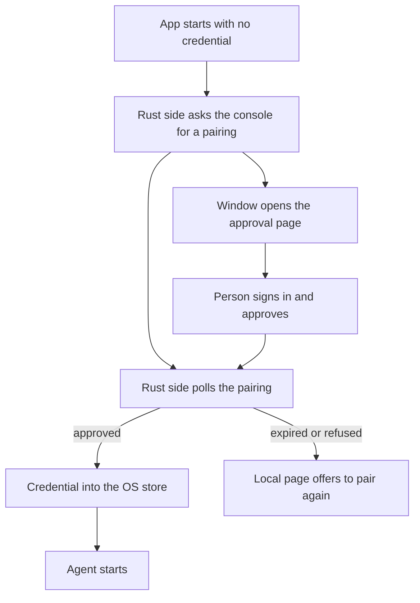

# The desktop app

The desktop app is BMO's web console in a window of its own that carries a jake agent inside it. It is
the second way a person's machine is joined to the hub, beside the one-line install (docs/install.md),
which stays as it is. This document is the canonical statement of the app; the `desktop` crate answers
to it.

## What it is

- **The hosted console in a window.** The main window loads the console the deployment serves, not a
  copy bundled into the app: the console is rendered on its server and relays through that server, so
  only the hosted one works. Its address is a setting, `consoleUrl` in the app's `settings.json` under
  the app's per-user config directory, and defaults to `https://ai.example.org/bmo/`.
- **A built-in agent while the app runs.** The app runs the agent crate as a library on its own
  runtime, under the person's own machine credential, so the machine is reachable through the hub for
  as long as the app is open, with the same shells, transfers and streams an installed agent offers.
- **A window with no frame of its own.** The window carries no native title bar and no menu bar; the
  console draws the window's top bar and its controls itself (「The window's frame」).
- **A tray icon.** The tray opens the console again, shows the agent's state in its tooltip, turns
  starting at sign-in on and off, and quits. Quitting stops the agent.
- **Settings of its own,** set in the console's own settings while the console runs in the app:
  whether control is kept while the PC is locked, what closing the window does, starting at sign-in,
  starting in the tray, keeping the PC awake, and which channel its updates come from (「Settings」).
- **One copy at a time.** A second launch brings the running copy's window forward and exits, since two
  copies would hold one name twice.

## The crate and its workspace

- **`desktop` is a Cargo workspace of its own inside this repository,** reading the agent crate by its
  path, so the app and the installed agent run the same code with no dependency across repositories.
- **It stands outside the root workspace for two present reasons.** The root workspace is what the
  hub's deployment builds and lints in full, every package of it, and that build must need no webview
  system libraries and pay no webview build time. And the root's release build aborts on a panic,
  while the app is built with unwinding so that a panic in the agent ends only the agent's task.
- **Its checks are run apart:** `bun run check:desktop` lints, formats and tests it, on a machine that
  has the webview libraries (on Linux, WebKitGTK 4.1 and its development files). `bun run check`
  stays the whole check of the root workspace and the console.

## The agent as a library

- **The agent crate is a library as well as the `jake` executable.** The executable reads `agent.env`
  and runs as it always has; the library entry is what the app calls.
- **The entry takes its configuration in memory:** the hub URL, the agent's name and its credential,
  with every other setting at the default an empty `agent.env` would give. It reads no file and no
  environment variable.
- **It runs on the caller's runtime** and ends when the caller's stop signal resolves, when the hub
  sends a leave, or, where the caller asked for it, when the hub hands the agent's name to another
  connection. Its answer says which of the three ended it.
- **It reports its link as it goes:** connecting, attached, refused by the hub, or unable to reach it,
  through a watch the caller reads.
- **It says what it would launch for a command without launching it:** for an exec frame and a
  platform, the program, its arguments, the directory and the environment overlay. The crate's
  `exec-invocation` example prints that for a frame on standard input, which is how the hub's
  contract tests hold a Windows launch, WSL's among them, on a Linux machine.
- **A leave asks nothing of the machine.** The library does not uninstall anything; the executable
  runs its departure after the entry answers that the hub sent a leave, and the app forgets its
  credential instead (「Keeping the agent running」).

## Pairing

The app never asks for the shared secret and never shows a credential. It obtains the person's own
machine credential, `<name>.<mac>` (docs/architecture.md, 「Configuration and secrets」), through the
console's device pairing, which the account service mints for the machine the signed-in person's
account is bound to.

- **The contract with the console.** A pairing is asked for with an unauthenticated
  `POST /api/desktop/pairings` under the console's address, answered with the pairing's id, a short
  code, the approval page's address and how many seconds to wait between polls. The app polls
  `GET /api/desktop/pairings/<pairing>`: 202 while waiting, 200 with the machine's name, its credential
  and the hub's URL once approved, which is answered once only, and 410 once the pairing expired or was
  refused. A pairing expires after ten minutes.
- **The page never touches the credential.** The Rust side asks for the pairing and polls it over its
  own HTTPS client; the window only shows the approval page, so the credential never passes through
  the page's JavaScript.
- **The code is shown on both sides.** The approval page shows the pairing's code, and the app shows
  the same code at the head of its main window's title, as `연결 코드 <code> · BMO`, so the person can
  see they are approving this app. Once the console answers, the main window shows the approval page
  itself, so the title bar is the one place the app's copy of the code stays visible; the code leads
  the title so a title cut short still shows it. The window has no native title bar, so the console
  draws that title, read from the window, in the top bar it draws on a page with no shell of its own
  (「The window's frame」); the operating system's taskbar shows it as well. The local page shows the
  code too, but only while the console cannot be reached.
- **The answer is checked before it is kept:** the credential must name the machine the answer names,
  and the hub's URL must be a WebSocket address. An approval page outside the console's origin is
  refused.
- **The built-in agent announces itself as the app's.** The version in its hello is always
  `desktop-<version>`, the app's own version behind the prefix `desktop-`. The prefix is a contract:
  the account service reads it to list the machine's kind as desktop, and it is what tells the
  built-in agent from an installed one, whose version names its build. The hub orders no update onto
  such a version (docs/install.md), since the app brings its agent along with its own updates.
- **A pairing that fails is offered again,** by a button on the local page; the app never asks the
  console for pairings in a loop of its own.

## The credential's storage

- **The credential is kept in the operating system's credential store**, through the `keyring` crate:
  Windows Credential Manager, the Secret Service on Linux, the Keychain on macOS. One entry, under the
  service `io.ahas.jake.desktop`, holds the machine's name, its credential and the hub's URL.
- **Where no store stands, nothing is kept.** On a Linux machine with no Secret Service, a headless one
  or a WSL distribution without a desktop session, the app says the credential cannot be kept, starts
  no pairing and runs no agent. It never writes the credential to a file.
- **A credential the hub refuses is kept.** The agent keeps redialling and the state reads as refused,
  since a refusal from a hub that has not yet learnt the key is cured on the hub's side.

## Keeping the agent running

- **The agent runs as one task the app supervises.** The app is built with unwinding, so a panic ends
  that task alone and the app stays up.
- **A task that panics is started again after a pause** that doubles from one second to a ceiling of
  five minutes, and returns to one second once a run has lasted ten minutes. The state reads as
  restarting while it waits.
- **A leave from the hub ends the built-in agent for good:** the app deletes the stored credential,
  stops the agent and offers pairing again, since the hub has removed this machine.
- **The state is shown** in the tray icon's tooltip and on the local page: starting, pairing, pairing
  failed, no credential store, connecting, attached, refused by the hub, hub unreachable, restarting
  after a fault, paused while the PC is locked, held off for an installed agent, given up to another
  agent of its name, and removed by the hub.
- **A state that waits on the person shows the local page in the main window,** in place of the
  console: a pairing that failed, no credential store, the name given up to another agent, and the
  machine removed by the hub. Each stops the app's course until the person asks it to go on, and the
  local page is where that ask is made, beside the way back to the console. A state that needs nothing
  of the person, held off for an installed agent among them, leaves the console where it is.

## One agent per name

The hub keeps one connection per name, and a newer hello replaces the older (docs/architecture.md,
「Many agents, one hub」). Two agents of one name that both redialled would replace each other without
end, so the built-in agent gives way, twice over.

- **It does not start beside an installed agent of its name.** Before the agent starts, the app looks
  for an installed jake agent running on the machine: on Windows by the agent's single-instance lock in
  its data directory, held by a live process; on Linux by the main process of the `jake-agent` user
  unit. The running executable's own folder holds the `agent.env` that names it. Where that name is the
  built-in agent's, the built-in agent stays off and the app says an installed agent already serves
  this machine, offering to keep using it, with a button that looks again.
- **It yields to any agent that takes its name.** When the hub closes the built-in agent's connection
  as superseded by a new one, the built-in agent stops instead of redialling, and the app reads as held
  off for another agent of its name. An installed agent the first check cannot see, one inside a WSL
  distribution of the same machine, therefore wins after a single replacement, and the two never loop.
- **The installed agent is unchanged:** it redials when superseded, as it always has.

## Settings

The app's settings are kept in its `settings.json`, the file that holds the console's address.

| Key | Setting | Default | Offered on |
|---|---|---|---|
| `keepControlWhileLocked` | Keep control while the PC is locked | on | Windows |
| `closeToTray` | Closing the window sends it to the tray rather than quitting | on | every platform |
| `startAtSignIn` | Start the app when the person signs in | off | every platform |
| `startInTray` | Start in the tray, with no window, when started at sign-in | off | every platform |
| `keepAwake` | Keep the PC from sleeping while the built-in agent serves | off | Windows |
| `updateChannel` | The channel updates come from, `stable` or `nightly` (「The update channel」) | `stable` | every platform |
| `consoleUrl` | The console's address | `https://ai.example.org/bmo/` | the file alone |

### Reading and writing

- **A key the file does not hold takes its default.** A file that cannot be read whole, broken JSON, a
  value of the wrong type or a channel that is neither `stable` nor `nightly`, leaves the app on its
  defaults with the reason in its log, and the console's section then says the file cannot be read and
  the app changes nothing, since writing it would overwrite the hand edit it could not read.
- **A byte-order mark at the file's start is read past,** since Windows editors and PowerShell write
  one before UTF-8; the app writes none.
- **A change is written the moment it is made,** the whole file replaced by a rename, so a reader never
  sees half of it. Every key the app does not know is written back as it was read, so a key a newer
  version wrote survives an older one.
- **Every setting takes effect at once,** with no restart: each is read again where it acts, at the next
  close of the window, the next lock of the session, the next sign-in, or at once where it holds
  something now (starting at sign-in, keeping awake, and the update channel, whose change asks its feed
  at once).
- **The console's address is not in the console's section.** Another address is another console, whose pairing
  the stored credential does not answer to, so it stays a hand edit read at start.

### Closing the window

- **On, closing the window hides it** and the agent carries on until the tray's quit.
- **Off, closing the window quits the app** as the tray's quit does: the built-in agent stops first, then
  the app exits.

### Starting at sign-in

- **The registration is per-user and needs no administrator rights,** made through the `auto-launch`
  crate: a run entry in the person's own registry hive on Windows, an autostart entry in the person's
  config on Linux. It is never the machine-wide run entry, even where the app runs elevated, since that
  one would start the app for every account. The entry names the app's executable in quotes, so a path
  with a space in it still starts. It fires at the person's sign-in, not at boot; on a machine that
  signs in by itself at boot the two are one moment.
- **The file holds the wanted state, and the registration is brought into line with it** whenever the
  setting changes and at every start of the app, so a registration a reset of the machine wiped is put
  back the next time the app runs. Where the file holds no value, the registration as it stands is
  taken as the setting and written into the file.
- **The tray's check item and the console's section show the one value:** a change from either is
  written to the file; the tray's item follows a change made in the console at once, and the console
  shows a change made from the tray the next time it reads the settings.
- **A registration the system refuses leaves the setting as it was,** with the reason shown where the
  change was made: beside the switch in the console, and in the log for the tray, whose item springs
  back.
- **Starting in the tray.** The registration starts the app with an argument that says it was started
  at sign-in. Started so with `startInTray` on, the app opens no window: the tray and the agent start as
  they always do, and the tray opens the window. Started by hand, the app always opens its window. A
  pairing needs the person, so one that opens shows the window however the app was started.

### The update channel

- **Two channels, each with a feed of its own** (「Releases」). `stable` takes the set's releases alone,
  the versions the owner declares; `nightly` takes the day's build between releases as well, named
  `<next minor>-nightly.<YYYYMMDD>`, as bmo-chat's `docs/conventions.md` 「Versions」 states. `stable` is
  the default, and a file that names no channel runs on it.
- **The app asks its channel's feed,** the address Tauri's updater is given at each check: the stable
  feed is the configuration's own updater endpoint, and the nightly feed is `nightly/latest.json` beside
  it. A change of channel asks the new channel's feed at once, and from then on at the usual times.
- **An update is taken only where its version is higher than the running one,** by semver, on either
  channel. Semver orders a nightly before the release it leads to and after the release before it, so:
  - **Stable to nightly** takes the newest nightly at once, since it stands above the release it follows.
  - **Nightly to stable never goes back.** The installed nightly stays until a release higher than it is
    published: a nightly of `1.1.0` is replaced by `1.1.0` or a later release, never by the `1.0.0` it
    followed. To return to a stable version at once, the person installs it by hand from the download
    page.

### Where the settings are set

- **In the console's own settings, in a section of their own that stands only in the app's window.**
  The console reads the settings and changes one at a time through the app's bridge (「The window and
  what the console may call」); in a browser no bridge answers and the section is not there. The
  section's wording and layout are the console's (its `docs/web.md`, 「Settings」).
- **What the bridge hands the console is what the section draws:** the switches this platform offers,
  each with its value, the update channel, and why the file cannot be changed, where it cannot. Only the
  settings the platform offers are handed over, so only those are drawn.
- **Each switch and the channel take effect and are written the moment they are changed;** nothing is
  held unsaved. A change that fails leaves the saved value standing and answers with the reason, which
  the console shows beside the setting.
- **The app keeps no settings screen of its own.** Every setting acts while the app runs whether the
  console is shown or not, and each is reached in the console as soon as it loads; starting at sign-in
  is also the tray's check item, and quitting the tray's. While the console cannot be reached the local
  page offers to try it again, not the settings.

## While the PC is locked

### What a locked Windows session allows

Locking hands the screen and input to the system's secure desktop. The person's session, its
processes and its network stay as they were.

- **What goes on:** the app and its built-in agent keep running and the agent stays attached. Commands
  run as the person, with their files and network, and may start programs; transfers, byte streams and
  streams back carry on.
- **What stops:** everything that needs the screen or input. A process of the person's cannot read the
  secure desktop, so a screenshot taken by a command fails; keys and pointer movements a command
  injects reach nothing; a window a command opens stands behind the lock, unseen.
- **What no process of the person's can do:** see or drive the lock screen, or unlock the session.
  The lock screen and the secure attention sequence belong to the system.
- **The remote desktop.** BMO's remote desktop reaches only the machine its own service runs on,
  through that machine's RDP server, and does not reach a machine through jake, locked or not. A
  remote desktop that shows and drives a locked Windows session needs either a helper running as a
  system service, which captures the secure desktop and injects input from the system account, or
  Windows's own Remote Desktop host, whose logon takes the session over. Both need administrator
  rights to install, which this per-user app does not have, and the app offers neither.
- **Sleep.** Locking does not sleep the PC, but a locked PC left alone is idle, and the power plan
  sleeps it after its idle time; a sleeping PC drops the connection until it wakes. `keepAwake`
  answers that.

### Keeping control while locked

- **On, nothing changes when the session locks:** the agent stays attached and serves all that a locked
  session allows.
- **Off, the moment the session locks the app stops the built-in agent,** with the stop signal its quit
  uses, so the connection closes and everything in flight ends as it does on a lost connection: running
  commands' process trees are ended, transfers fail, streams and streams back close. The hub lists the
  machine as not attached, not as departed, and the state reads as paused while the PC is locked.
- **On unlock the agent starts again at once.** A pause is not a fault, so it leaves the restart pause
  after a panic as it was.
- **Stopping rather than refusing.** Staying attached and refusing each request would need the agent
  library, shared with the installed agent, to carry a lock gate and a refusal the hub and the console
  surface, and would leave a stream already open live; stopping ends every kind of control at once, by
  the path a lost connection already takes.
- **How the lock is read.** The app registers for its own session's change notifications, taking a lock
  and an unlock as they come, and reads at start whether the session is locked, so an app started
  behind a lock starts paused. Switching to another person's account locks the session and counts as a
  lock.
- **A change takes effect at the next lock.** A pairing under way when the session locks goes on, and
  the agent it ends in starts once the session is unlocked.
- **It governs the built-in agent alone.** An installed agent is not the app's and serves while the
  session is locked; where one serves the machine, the built-in agent is held off and the setting has
  nothing to govern.
- **On Linux the app reads no lock,** so the setting is not offered and the agent serves whether the
  session is locked or not.

### Keeping the PC awake

- **On, while the built-in agent serves,** the app asks Windows to keep the system from sleeping for
  idleness, a request any per-user process may make. The display still turns off and the session
  still locks as the power plan says; a sleep the person chooses, a closed lid and the power button
  still sleep it.
- **The request is released** while the agent is paused or held off, when the setting is turned off,
  and when the app quits.
- **Off, the power plan alone decides,** as it does for any program.

## The window's frame

- **The window has no native title bar and no menu bar, on every platform.** The console fills the
  window to its top edge and draws the window's top bar itself, as its own title bar, while it knows
  it runs in the app (its `docs/web.md`, 「The desktop app's window」). Quitting is the tray's, and the
  operating system's own close and quit.
- **Who draws the window's controls differs by platform, and the app says which** in what the bridge
  hands the console (「The window and what the console may call」):
  - **On Windows and Linux the window is undecorated,** and the console draws minimise, maximise or
    restore, and close at its top bar's right end, in its own colours and following its light and dark
    mode. Each asks the window through the bridge. Tauri 2 offers no title bar overlay on these
    platforms, so no native controls stand over the page.
  - **On macOS the title bar is an overlay with its title hidden:** the system's own three buttons
    stand inset at the top left over the console, and the console leaves their room free and draws no
    controls of its own.
- **The console's top bar is the window's drag region.** Pressed and dragged where nothing pressable
  stands, it moves the window, and a double press maximises or restores it, as the system's title bar
  does; the buttons, links and fields in it stay pressable. On a page with no shell of its own the
  console draws a thin bar holding the window's title, the drag region and the controls, so every page
  can be moved and closed.
- **The window is resized from every edge and corner.** An undecorated window keeps the edges Tauri
  gives it for resizing on Windows and Linux, and the macOS overlay keeps the system's own.
- **The local page draws the same bar** for itself, the window's title at its left and the controls
  at its right where the app says the page draws them, since it fills the same frameless window.
- **Closing from the drawn close is the window's close,** so it hides the window or quits as
  `closeToTray` says (「Closing the window」).

## The window and what the console may call

- **Navigation stays under the console's address.** The main window goes only to pages of the
  console's origin whose path lies under `consoleUrl`'s, and to the app's own bundled page; a link to
  anywhere else, another path of the console's own host among them, opens in the person's default
  browser. Another site served beside the console on its host therefore never stands in the window,
  which is what keeps the bridge, granted to the console's origin, to the console's own pages.
- **The bundled page** says when the console cannot be reached, shows the agent's state and the
  pairing code, and offers to try the console again, pair again, or look again for an installed agent
  or a credential store.
- **The console's pages get a narrow bridge, and nothing else.** The bridge is one capability the app
  adds as it starts, scoped to the main window and to remote pages of the configured `consoleUrl`'s
  origin, its scheme, host and port, so another site, another scheme or port and a page in another
  window are given nothing. The webview names the page asking to the app by its origin alone, so the
  scope cannot be narrower than the origin; the window's navigation keeps it to the console's own
  path. The scope follows `consoleUrl` as the app read it at start, since the capability is built from
  it then.
- **The bridge holds two of the app's commands and the window's own controls:**
  - `settings` reads the settings: each switch the platform offers with its value, `updateChannel`,
    `stable` or `nightly`, why the file cannot be changed where it cannot, and `windowControls`,
    `console` where the page draws the window's controls and `inset` where the system's stand inset at
    the top left.
  - `change_setting` changes one setting by its key, `setting`: a switch's camelCase key with `on`,
    true or false, or `updateChannel` with `value`, `stable` or `nightly`. The app checks it before
    anything is written: an unknown key, an `on` that is not true or false and a `value` that is no
    channel are refused as the call is read; a switch given no `on` or a `value`, the channel given no
    `value` or an `on`, and a switch this platform does not offer are refused with the reason. It
    answers with the settings as they now stand.
  - The window's own commands for its frame: minimise, toggle maximise, close, start dragging, the
    double press's maximise, whether it is maximised, and its title. Nothing else of the window, and
    no other plugin's command.
- **Nothing more is given:** no shell, no file, no process, no opener, no other window, and none of
  the bundled page's commands (the status, trying the console again, retrying). A newer command the
  console wants is added to the bridge here and in the console's document together.
- **The console tells the app apart by the bridge alone:** a page that can call `settings` and is
  answered runs in the app's window; anywhere else nothing answers, and the console draws nothing of
  the app. Nothing is guessed from the user agent.
- **The bundled page has a capability of its own,** scoped to the main window and the app's own
  origin: read the status, try the console again, retry, read the settings for `windowControls`, and
  the same window commands for its frame.
- **Pairing needs no hand-off from the page,** because the Rust side polls for the approval itself.
- **The console is checked before it is shown:** the app asks the console's address over HTTPS first,
  and shows the bundled page with the reason when it does not answer.

## Distribution and updates

- **Windows first:** an NSIS installer that installs for the current user alone and needs no
  administrator rights. It is unsigned until an Authenticode certificate exists, which is the owner's
  decision, so Windows SmartScreen warns on first run until then.
- **Linux second:** an AppImage and a deb package.
- **Updates go through Tauri's updater plugin with its signature check.** The app checks its channel's
  feed (「The update channel」) at start, every six hours and when the channel changes, and installs an
  update only once its signature verifies against the public key built into the app.
- **The update key is the owner's.** It is made once with `cargo tauri signer generate`, which writes a
  private key and asks for its password; the private key and its password are kept outside every
  repository, in the deployment's secret store (the data root's env folder), a file each, readable by
  their user alone, and are handed to a release build through the `TAURI_SIGNING_PRIVATE_KEY` and
  `TAURI_SIGNING_PRIVATE_KEY_PASSWORD` environment variables alone. Neither is ever committed. The
  public key is written into the updater's `pubkey` in the app's Tauri configuration.
- **The public key is written in, and the bundle makes updater artifacts,** which a release build signs
  with the private key; a release build without the two variables fails rather than ship an unsigned
  update. The app checks the feed and installs an update in Windows's passive mode, showing its progress
  and asking nothing. An app built from a configuration with no updater entry checks for none.
- **The feeds are served beside the agent's builds,** the stable one at
  `https://ai.example.org/bmo/jake/desktop/latest.json` and the nightly one at
  `https://ai.example.org/bmo/jake/desktop/nightly/latest.json`, with the installers and their signatures
  they name (「Releases」).
- **A build** runs `cargo tauri build` inside the `desktop` folder. The NSIS installer is built on
  main-host as well as on a Windows machine: cross-compiled for `x86_64-pc-windows-gnu` with
  `cargo-zigbuild` as the CLI's runner and `--bundles nsis`, which needs `nsis` and the mingw-w64
  binutils and C compiler for the app's Windows resources. The AppImage and the deb are built on a
  Linux machine with WebKitGTK.

## Releases

A release is one version of the app, built for every platform at once, signed for the updater and
published where both the updater and the console read it. It goes out on one of two channels, as bmo-chat's
`docs/conventions.md` 「Versions」 states the set's versions:

- **`stable`** carries the set's releases, the versions the owner declares, and is what the app takes
  unless its setting says otherwise.
- **`nightly`** carries the day's build between releases, named `<next minor>-nightly.<YYYYMMDD>`: the
  minor above the release the app's configuration names, then the day it was built in the platform's
  time zone, `Asia/Seoul`, as `1.1.0-nightly.20261124` after `1.0.0`. A second nightly the same day adds
  `.<n>` counting from 2, `1.1.0-nightly.20261124.2`, so each stands above the one before it.

### Where releases are kept

- **The release folder is the `desktop` folder of the agent's served layout:** on main-host the
  directory `/var/www/ahas-ai/bmo/jake/desktop/`, which the `ai.example.org` site serves statically as
  `https://ai.example.org/bmo/jake/desktop/`. The folder belongs to the user that runs releases, so a
  release writes it without root; serving the path is host infrastructure BMO owns.
- **Each stable version has a folder of its own at the top,** named by the bare version (`1.0.0`),
  and each nightly one under `nightly/` (`nightly/1.1.0-nightly.20261124/`). A version's folder holds
  the Windows installer, the AppImage and the deb, each beside its updater signature, and that
  version's release read. A published version is never written again: the updater installs only a
  version higher than the running one, so a fix ships as a new version.
- **Only the seven newest nightlies are kept.** Once a nightly is published, the folders of older
  nightlies past the seventh are removed, since a feed only ever names the newest. A stable version's
  folder is never removed.
- **Each channel has its updater feed,** in the form Tauri's updater reads, naming that channel's
  newest version: `latest.json` at the folder's top for `stable`, where installed apps have always
  read it, and `nightly/latest.json` for `nightly`. Beside them `release.json` at the top is the read the
  console uses, holding both channels. Each is replaced whole, by a rename, and only once the version's
  folder is complete, so none ever names a file that is not yet there.
- **A feed names every installer the updater may take,** each with its signature and its address:
  the NSIS installer under `windows-x86_64-nsis` and `windows-x86_64`, the AppImage under
  `linux-x86_64-appimage` and `linux-x86_64`, and the deb under `linux-x86_64-deb`. An app installed
  from the deb looks for the deb's key first, so it is never handed an AppImage.

### The read the console uses

The console builds its download page against this contract alone, and the project's site its download
section.

- **It reads `https://ai.example.org/bmo/jake/desktop/release.json`,** a JSON object whose top level always
  describes the current stable version. The same top level is kept in that version's own folder, at
  `https://ai.example.org/bmo/jake/desktop/<version>/release.json`, and never changes there.
- **The object holds:** `version`, the bare semantic version; `date`, when it was published, as an
  RFC 3339 UTC timestamp; `files`, one entry per installer; and `nightly`, the newest nightly as an
  object of the same `version`, `date` and `files`, absent until the first nightly is published. A
  nightly's own folder keeps its object at `nightly/<version>/release.json`.
- **Each entry of `files` holds:** `platform`, `windows` or `linux`; `arch`, `x86_64`; `format`,
  `nsis`, `appimage` or `deb`; `file`, the file's name; `size`, its length in bytes; `sha256`, its
  SHA-256 digest in lowercase hex; and `url`, the absolute address it downloads from.
- **The download route is each entry's `url`,** a file in the version's folder served as it is, so
  a link to it downloads the installer and a stable version's link never changes once published.
- **No release yet reads as not found:** until the first release is published the address answers
  404, and the console shows that the app is not yet available. A nightly is published only after a
  stable release, so the top level is always there once the read is.
- **A field may be added and none is removed or renamed,** so a console built against this contract
  reads every later release.

### Making a release

- **A release is one command run on main-host from the repository's root, naming its channel:**
  `bun run release:desktop --channel stable` or `bun run release:desktop --channel nightly`. It runs
  `scripts/desktop-release.ts` under a memory cap of its own, and that builds the app for Windows and
  then for Linux, one after the other, finds the installers and their signatures, and publishes them.
  A channel that is not named, or neither of the two, stops it before anything else.
- **`--dry-run` builds and writes nothing:** it reads the published reads, works out the version and
  checks it, and prints the channel, the version and where it would be published.
- **The stable version is the one in the app's Tauri configuration,** the set's release version,
  moved only in the commit that releases the set. A version not higher than the stable one already
  published is refused before anything is built.
- **The nightly version is worked out as the build starts,** from the configuration's version and the
  day, and handed to that build alone as an override of the configuration's version on the Tauri CLI's
  command line; nothing is written into the repository, and no commit carries it. A nightly is refused
  before anything is built where no stable release is published yet, and where its version is not higher
  than both the published nightly and the published stable, which is a checkout behind the release.
- **The address it is published under** is the folder holding the configuration's updater endpoint,
  and the nightly's the `nightly/` folder in it, so no address is stated twice.
- **The update key is read from the deployment's secret store by its path:** the env folder holds
  `jake-desktop-updater.key` and `jake-desktop-updater.password`, and the release hands the key to the
  build as its path and the password through its variable, printing neither. Where either file is
  missing the release stops before building.
- **Every installer and every signature must come from this run:** a file the build did not write
  afresh stops the release, so a stale build is never published under a new version.
- **A release rewrites only its own channel:** a stable release replaces `latest.json` and the top
  level of `release.json`, keeping its `nightly`; a nightly replaces `nightly/latest.json` and the
  `nightly` of `release.json`, keeping the top level.
- **The release ends by printing** the channel, the version and, for each installer, its name, its
  size, its SHA-256 and its address.
- **The Authenticode signature is not part of it:** the installer stays unsigned for Windows until
  the owner provides a certificate (「Distribution and updates」).
